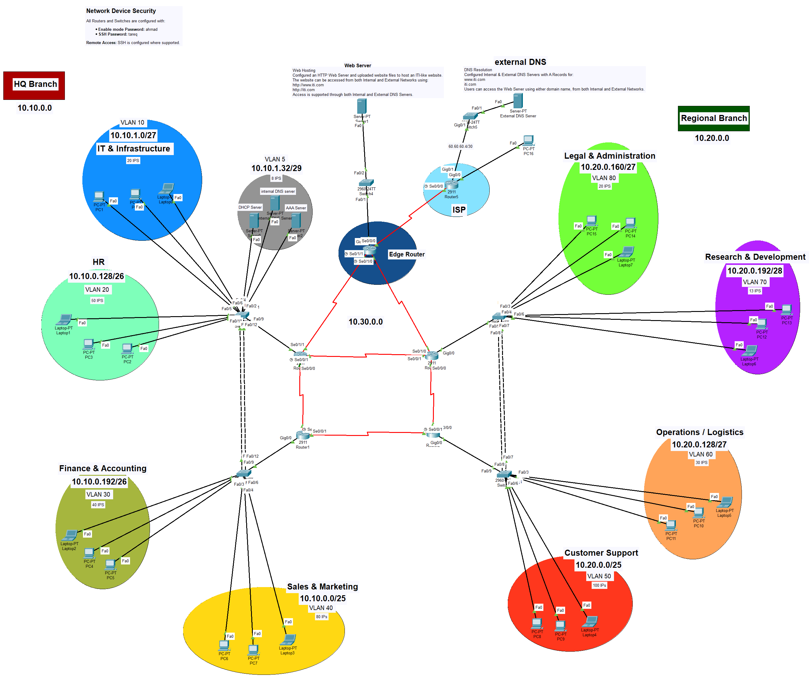
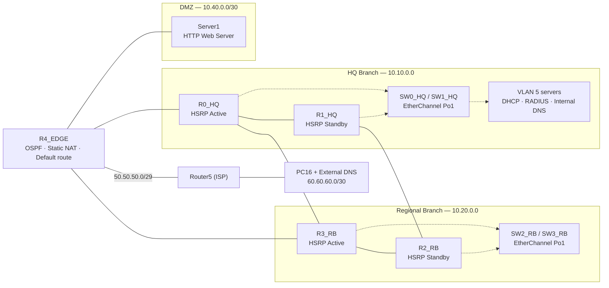
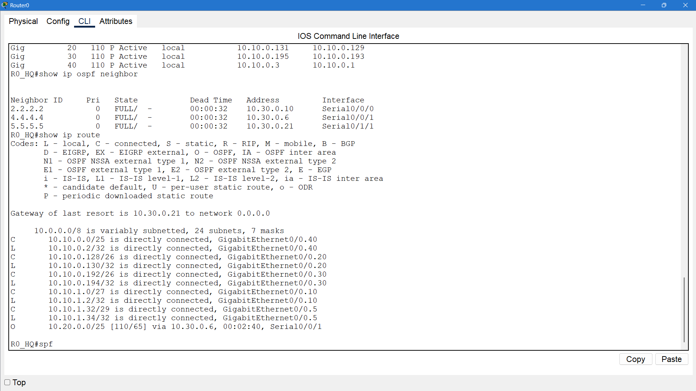
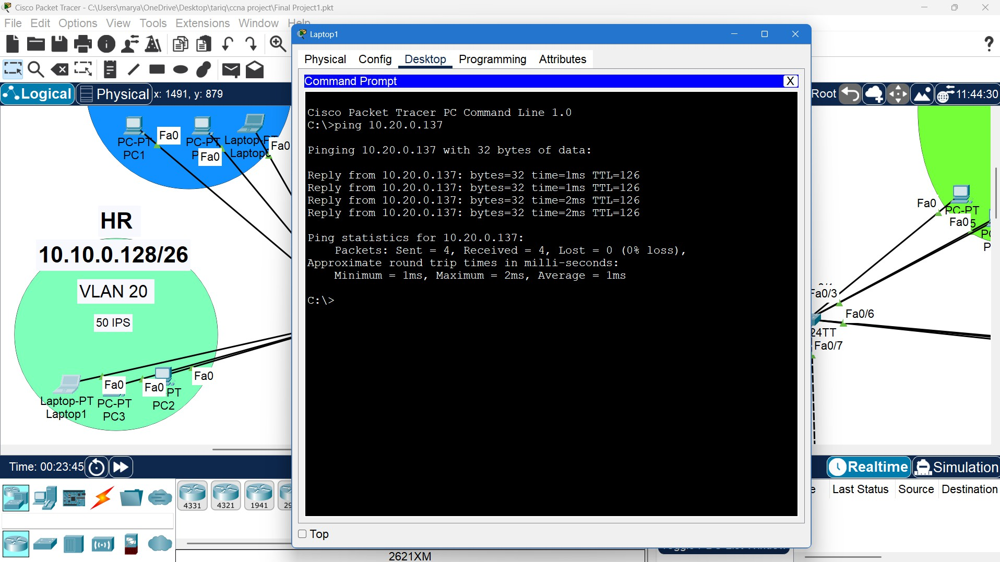
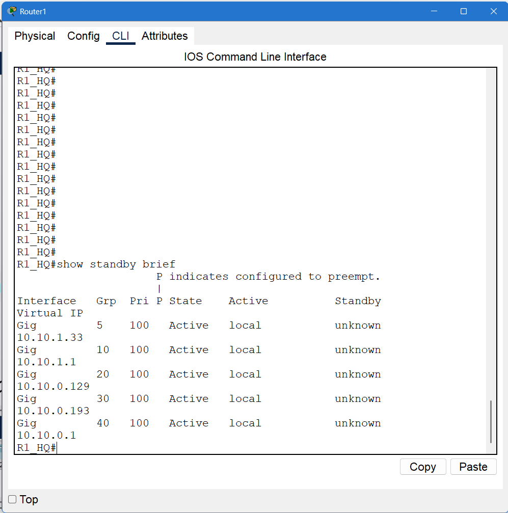
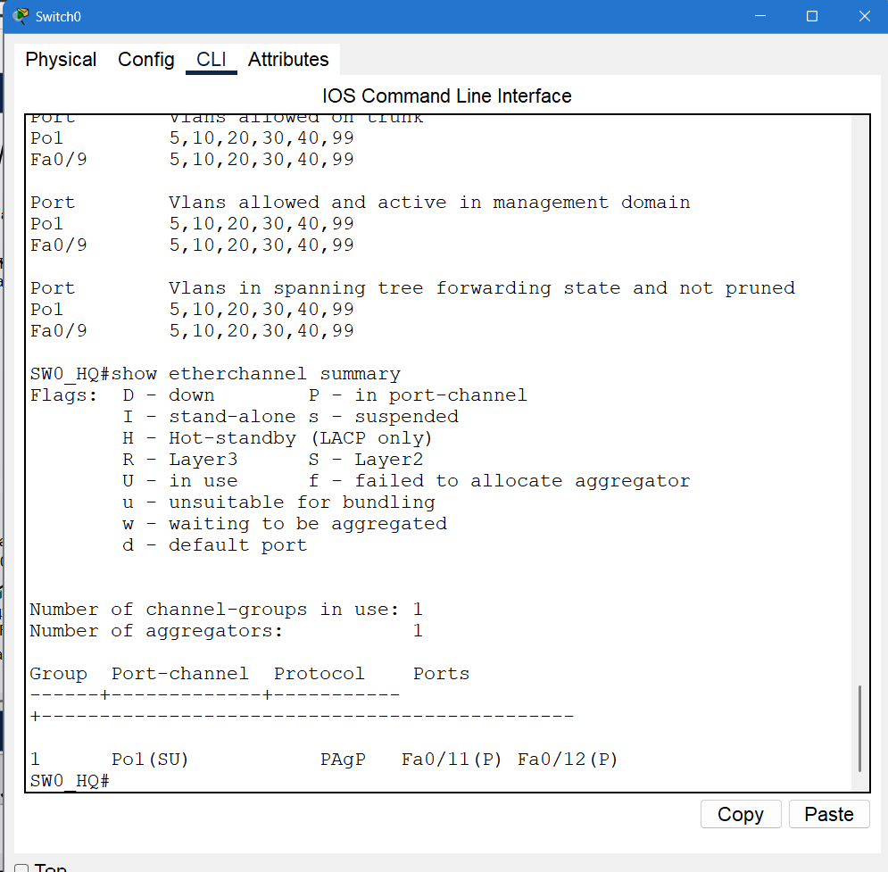
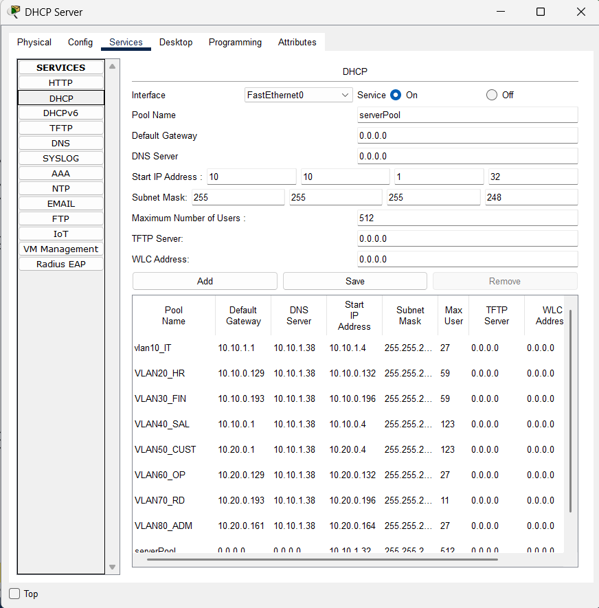
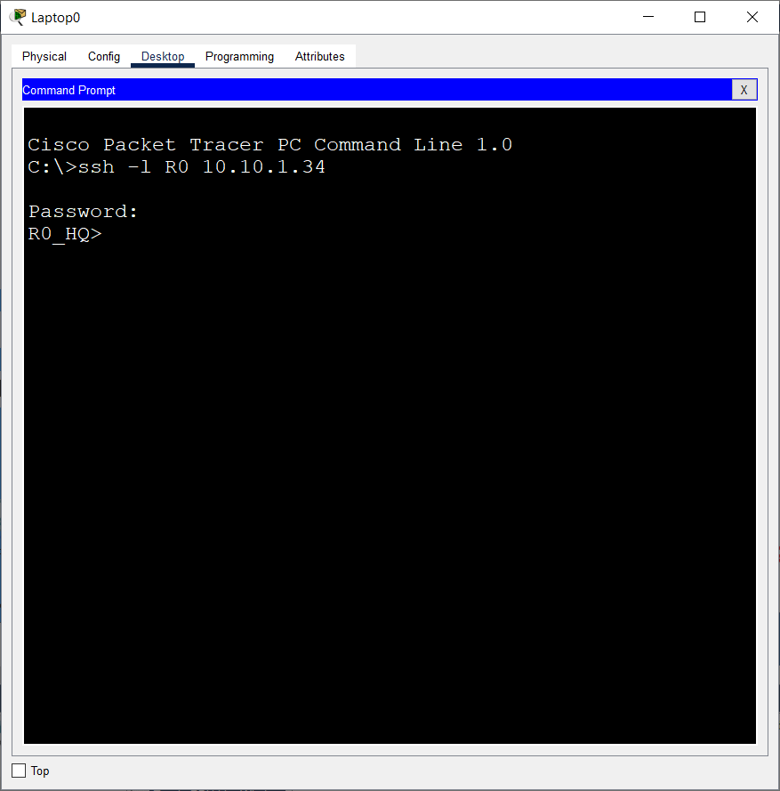
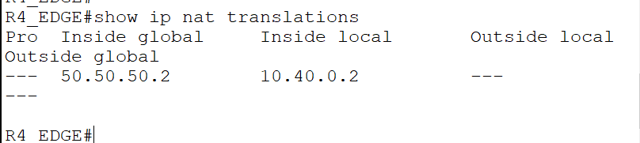
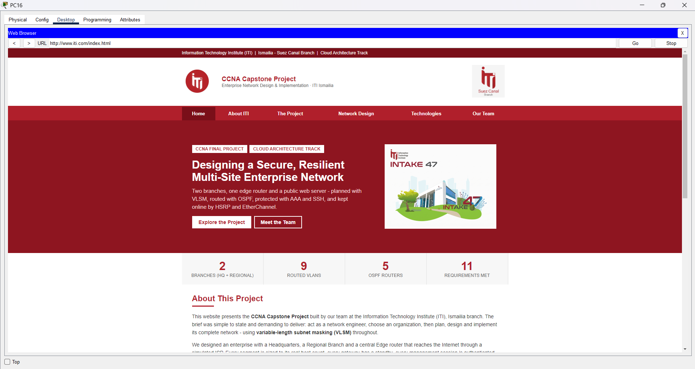

<div align="center">

# 🌐 Enterprise Multi-Site Network — CCNA Final Project

**Design, addressing and full implementation of a two-branch enterprise network with an ISP edge, built in Cisco Packet Tracer 8.2.2**


*Information Technology Institute (ITI) — CCNA Final Project*

🔗 **[Live website demo](https://islamramadanahmed.github.io/ITI-9M-Cloud-Architecture-CCNA-Project/web/)**

</div>

---

## 📑 Table of Contents

- [Overview](#-overview)
- [Network Topology](#-network-topology)
- [Features & Technologies](#-features--technologies)
- [IP Addressing Plan (VLSM)](#-ip-addressing-plan-vlsm)
- [Key Configuration Highlights](#-key-configuration-highlights)
- [Hosted Website](#-hosted-website)
- [Verification & Screenshots](#-verification--screenshots)
- [Requirements Matrix](#-requirements-matrix)
- [Repository Structure](#-repository-structure)
- [How to Run the Project](#-how-to-run-the-project)
- [Lab Credentials & Security Note](#-lab-credentials--security-note)
- [Team](#-team)

---

## 📌 Overview

This project simulates a **multi-site enterprise network** made of a **Headquarters (HQ)** branch and a **Regional Branch (RB)**, both connected through a central **Edge router** to a simulated **ISP**. It covers the full CCNA skill set: VLSM planning, VLAN segmentation, inter-VLAN routing, first-hop redundancy, dynamic routing, centralised DHCP, centralised authentication, device hardening, NAT and DNS-based web publishing.

The design follows a **high-availability** and **defence-in-depth** approach:

| Principle | How it is achieved |
|---|---|
| Efficient addressing | **VLSM** on every segment — smallest prefix that fits each department |
| No single point of failure (L3) | **HSRP** router pairs at each branch (Active / Standby with preempt) |
| No single point of failure (L2) | **PAgP EtherChannel (Po1)** between the redundant switch pairs |
| Fast convergence | **OSPF single-area** across all internal routers |
| Centralised services | One **DHCP server** + **DHCP relay**, one **RADIUS (AAA)** server |
| Secure management | **SSHv2 only** on VTY lines, RADIUS with local fallback, encrypted passwords |
| Public service publishing | **Static NAT** + internal & external **DNS** → website reachable by name |

All **11 mandatory requirements** were implemented and verified, plus an additional **HTTP web server** and **dual DNS** setup.

---

## 🗺️ Network Topology

<p align="center">
  
</p>

### Logical WAN view



---

## ✨ Features & Technologies

- **VLSM** addressing across 9 user VLANs and 9 WAN / DMZ / ISP / external links
- **VLANs & 802.1Q trunking** with a dedicated **native VLAN 99** (blackhole for unused ports)
- **Router-on-a-Stick** inter-VLAN routing on every branch router
- **HSRP** (group number = VLAN ID, priority 110 + preempt on the Active router)
- **PAgP EtherChannel** (`desirable` / `auto`) as an 802.1Q trunk
- **OSPF process 1, area 0** with manual router IDs, `passive-interface default`, and a default route originated by the Edge router
- **Standalone DHCP server** with 8 pools and `ip helper-address` relay on all branch routers (including cross-WAN)
- **AAA with RADIUS** (server on VLAN 5) and **local fallback**
- **SSH version 2** (1024-bit RSA), Telnet disabled on VTY
- **Static NAT** `10.40.0.2 ⇄ 50.50.50.2`
- **HTTP web server** hosting an ITI-style multi-page website, reachable from internal and external networks
- **Two DNS servers** (internal / external) with `iti.com` and `www.iti.com` A records

---

## 🧮 IP Addressing Plan (VLSM)

### HQ Branch — `10.10.0.0`

| VLAN | Department | Subnet | Hosts | HSRP VIP (GW) | Active / Standby |
|:---:|---|---|:---:|---|---|
| 40 | Sales & Marketing | `10.10.0.0/25` | 80 | `10.10.0.1` | `.2` / `.3` |
| 20 | HR | `10.10.0.128/26` | 50 | `10.10.0.129` | `.130` / `.131` |
| 30 | Finance & Accounting | `10.10.0.192/26` | 40 | `10.10.0.193` | `.194` / `.195` |
| 10 | IT & Infrastructure | `10.10.1.0/27` | 20 | `10.10.1.1` | `.2` / `.3` |
| 5 | Servers (static) | `10.10.1.32/29` | 8 | `10.10.1.33` | `.34` / `.35` |
| 99 | Native / blackhole | Layer 2 only | — | — | — |

### Regional Branch — `10.20.0.0`

| VLAN | Department | Subnet | Hosts | HSRP VIP (GW) | Active / Standby |
|:---:|---|---|:---:|---|---|
| 50 | Customer Support | `10.20.0.0/25` | 100 | `10.20.0.1` | `.2` / `.3` |
| 60 | Operations / Logistics | `10.20.0.128/27` | 30 | `10.20.0.129` | `.130` / `.131` |
| 80 | Legal & Administration | `10.20.0.160/27` | 20 | `10.20.0.161` | `.162` / `.163` |
| 70 | Research & Development | `10.20.0.192/28` | 13 | `10.20.0.193` | `.194` / `.195` |
| 99 | Native / blackhole | Layer 2 only | — | — | — |

### WAN, DMZ & External Links

| Link | Subnet | Endpoints |
|---|---|---|
| R3_RB ↔ R2_RB | `10.30.0.0/30` | `.1` / `.2` |
| R0_HQ ↔ R3_RB | `10.30.0.4/30` | `.5` / `.6` |
| R0_HQ ↔ R1_HQ | `10.30.0.8/30` | `.9` / `.10` |
| R1_HQ ↔ R2_RB | `10.30.0.12/30` | `.13` / `.14` |
| R4_EDGE ↔ R3_RB | `10.30.0.16/30` | `.17` / `.18` |
| R4_EDGE ↔ R0_HQ | `10.30.0.20/30` | `.21` / `.22` |
| R4_EDGE ↔ Server1 (DMZ) | `10.40.0.0/30` | `.1` / `.2` |
| R4_EDGE ↔ Router5 (ISP) | `50.50.50.0/29` | `.1` / `.3` (`.2` reserved for the NAT public IP) |
| Router5 ↔ PC16 | `60.60.60.0/30` | `.1` / `.2` |

> 💡 The Edge↔ISP link uses a **/29** instead of a /30 on purpose: a /30 would consume both `.1` and `.2`, leaving no room for the Static NAT public address `50.50.50.2`.

### Key servers

| Device | Address | Role |
|---|---|---|
| Server0 | `10.10.1.36/29` | Standalone DHCP server (8 pools) |
| Server2 | `10.10.1.37/29` | RADIUS / AAA server |
| Server1 | `10.40.0.2/30` | HTTP web server (DMZ) — public `50.50.50.2` |

---

## 🔧 Key Configuration Highlights

<details>
<summary><b>Router-on-a-Stick + HSRP</b> (R0_HQ, VLAN 40 example)</summary>

```
interface GigabitEthernet0/0
 no shutdown
!
interface GigabitEthernet0/0.99
 encapsulation dot1Q 99 native
!
interface GigabitEthernet0/0.40
 encapsulation dot1Q 40
 ip address 10.10.0.2 255.255.255.128
 ip helper-address 10.10.1.36
 standby 40 ip 10.10.0.1
 standby 40 priority 110
 standby 40 preempt
```
</details>

<details>
<summary><b>EtherChannel (PAgP)</b></summary>

```
interface range <two physical member ports>
 channel-group 1 mode desirable            ! 'auto' on the peer switch
!
interface Port-channel1
 switchport mode trunk
 switchport trunk native vlan 99
```
</details>

<details>
<summary><b>OSPF</b></summary>

```
router ospf 1
 router-id 1.1.1.1                 ! R0_HQ  (R1=2.2.2.2, R2=3.3.3.3, R3=4.4.4.4, R4=5.5.5.5)
 passive-interface default
 no passive-interface <serial WAN interfaces>  ! only WAN links send hellos
 network ... area 0
```
</details>

<details>
<summary><b>Static NAT on the Edge router</b></summary>

```
interface GigabitEthernet0/0
 ip nat inside
!
interface Serial0/0/0
 ip nat outside
!
ip nat inside source static 10.40.0.2 50.50.50.2
```
</details>

<details>
<summary><b>AAA (RADIUS) + SSHv2</b></summary>

```
aaa new-model
radius-server host 10.10.1.37 key <shared-secret>
aaa authentication login VTY_AUTH group radius local
!
ip domain-name company.local
crypto key generate rsa modulus 1024
ip ssh version 2
!
line vty 0 15
 login authentication VTY_AUTH
 transport input ssh
```
</details>

> The complete configuration of every device is stored inside the `.pkt` file (open any device → **CLI** → `show running-config`). Exact interface numbers are in the full report.

---

## 🌍 Hosted Website

The `web/` folder contains the ITI-style website uploaded to **Server1** (HTTP service) in the DMZ. It is deliberately written with **plain HTML tables and basic CSS (no flex/grid/JavaScript)** so that it renders correctly inside Packet Tracer's built-in browser.

| Page | Content |
|---|---|
| `index.html` | Home — project summary and highlights |
| `about.html` | About ITI and the Cloud Architecture track |
| `project.html` | The brief, requirements and how each was met |
| `network.html` | Topology, VLSM plan, device inventory |
| `technologies.html` | Technologies used |
| `team.html` | Team members |

- **Inside the simulation:** reachable at `http://www.iti.com` or `http://iti.com` from internal PCs (internal DNS → `10.40.0.2`) and from the external PC16 (external DNS → `50.50.50.2` via Static NAT).
- **Live demo (GitHub Pages):** [https://islamramadanahmed.github.io/ITI-9M-Cloud-Architecture-CCNA-Project/web/](https://islamramadanahmed.github.io/ITI-9M-Cloud-Architecture-CCNA-Project/web/)
- **Outside the simulation:** open `web/index.html` in any browser to preview the site locally.

---

## ✅ Verification & Screenshots

| | |
|:---:|:---:|
| <br/>**OSPF** — all neighbors in `FULL` state | <br/>**End-to-end ping** HQ (VLAN 20) → Regional (VLAN 60), 0 % loss |
| <br/>**HSRP failover** — standby takes over the Active role | <br/>**EtherChannel** — Po1 `SU`, members `P` |
| <br/>**DHCP** — 8 pools on the standalone server | <br/>**SSH login** authenticated through RADIUS |
| <br/>**Static NAT** translation table | <br/>**Website** opened from the external PC via `www.iti.com` |

📄 Every figure, table and `show` output is documented in the full report: [`docs/CCNA_Final_Project_Report.pdf`](docs/CCNA_Final_Project_Report.pdf).

---

## 📋 Requirements Matrix

| # | Requirement | Status | Verified with |
|:-:|---|:-:|---|
| 1 | VLSM across all segments | ✅ | IP plan review, no overlaps |
| 2 | OSPF dynamic routing | ✅ | `show ip ospf neighbor`, `show ip route` |
| 3 | VLANs + inter-VLAN routing (ROAS) | ✅ | `show vlan brief`, `show ip interface brief` |
| 4 | Standalone DHCP + relay | ✅ | `ipconfig` on HQ & Regional PCs |
| 5 | RADIUS AAA + local fallback | ✅ | SSH logins, RADIUS-disabled fallback test |
| 6 | Line password (first name) | ✅ | `show running-config` (encrypted) |
| 7 | Enable secret (second name) | ✅ | `show running-config` |
| 8 | Static NAT web server | ✅ | Browser test, `show ip nat translations` |
| 9 | EtherChannel (PAgP) | ✅ | `show etherchannel summary` |
| 10 | HSRP gateway redundancy | ✅ | `show standby brief`, failover test |
| 11 | SSH version 2 | ✅ | `show ip ssh` |
| ➕ | HTTP web server (ITI-style site) | ✅ | Browsing from PC16 |
| ➕ | Internal & external DNS | ✅ | A records on both servers |

---

## 📁 Repository Structure

```
.
├── README.md
├── packet-tracer/
│   └── CCNA_Final_Project.pkt        # Packet Tracer 8.2.2 project file
├── web/                              # ITI-style website hosted on Server1
│   ├── index.html · about.html · project.html
│   ├── network.html · technologies.html · team.html
│   ├── style.css
│   └── img/
├── docs/
│   ├── CCNA_Final_Project_Report.pdf # Full report (preview on GitHub)
│   └── CCNA_Final_Project_Report.docx
└── images/
    ├── topology.png
    └── screenshots/                  # Verification screenshots
```

---

## 🚀 How to Run the Project

1. Install **Cisco Packet Tracer 8.2.2** (or newer) — free from [Cisco Networking Academy](https://www.netacad.com/).
2. Clone or download this repository:
   ```bash
   git clone https://github.com/IslamRamadanAhmed/ITI-9M-Cloud-Architecture-CCNA-Project.git
   ```
3. Open `packet-tracer/CCNA_Final_Project.pkt` in Packet Tracer.
4. Optional: open `web/index.html` in a browser to preview the website on its own.
5. Wait a few seconds for OSPF and HSRP to converge (all links turn green), then try:
   - `ping` from an HQ PC to a Regional PC
   - `ssh -l R0 10.10.1.34` from a PC to R0_HQ
   - Browse to `http://www.iti.com` from **PC16** (external) and from any internal PC

---

## 🔐 Lab Credentials & Security Note

The credentials below are **course-mandated lab values** used only inside the simulation. They are published for reproducibility and must **never** be reused in a real environment.

| Item | Value |
|---|---|
| Enable secret | `ahmad` |
| Console / VTY line password | `tariq` |
| Local admin (AAA fallback) | `admin` / `ahmad` |
| RADIUS users | `R0` … `R4` / `tariq` |
| RADIUS shared secret | `cisco` |

---

## 👥 Team

| Name |
|---|
| **Tariq Ahmad Motawea** |
| **Islam Ramadan Ahmed** |
| **Khaled Ahmed Ghonem** |

**Supervised by:** Dr. Ekram · Eng. Hager Taha
**Institution:** Information Technology Institute (ITI)

---

<div align="center">
⭐ If you find this project useful, consider giving it a star.
</div>
